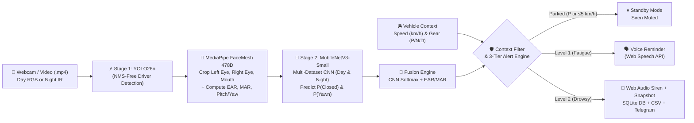
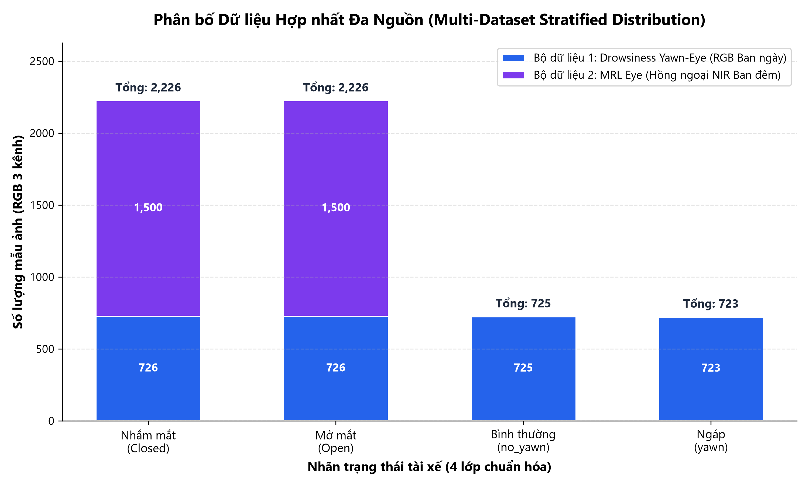
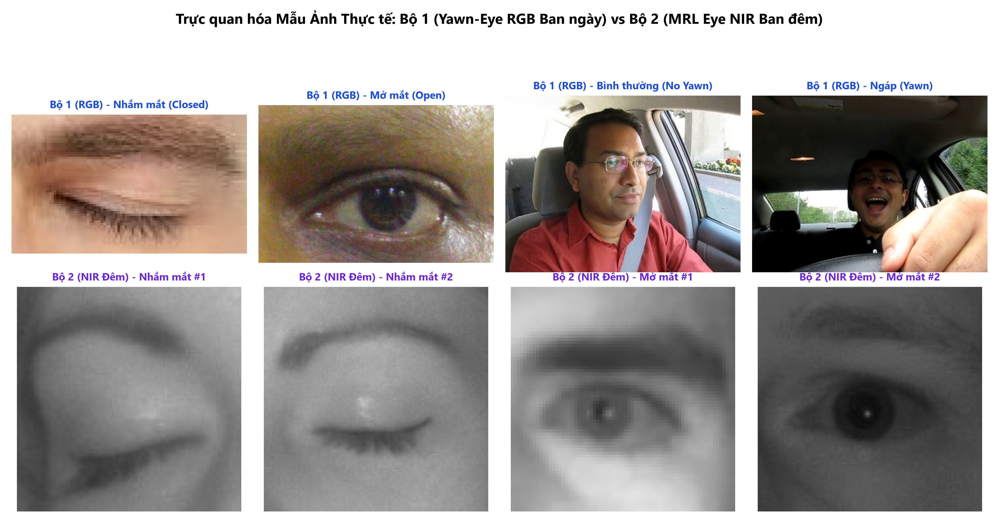
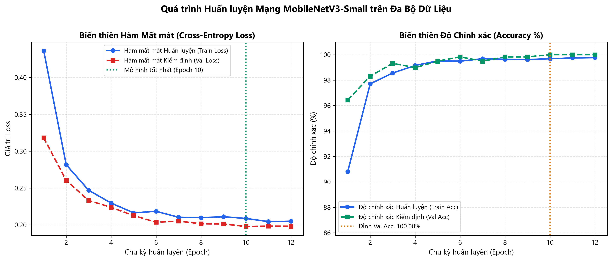
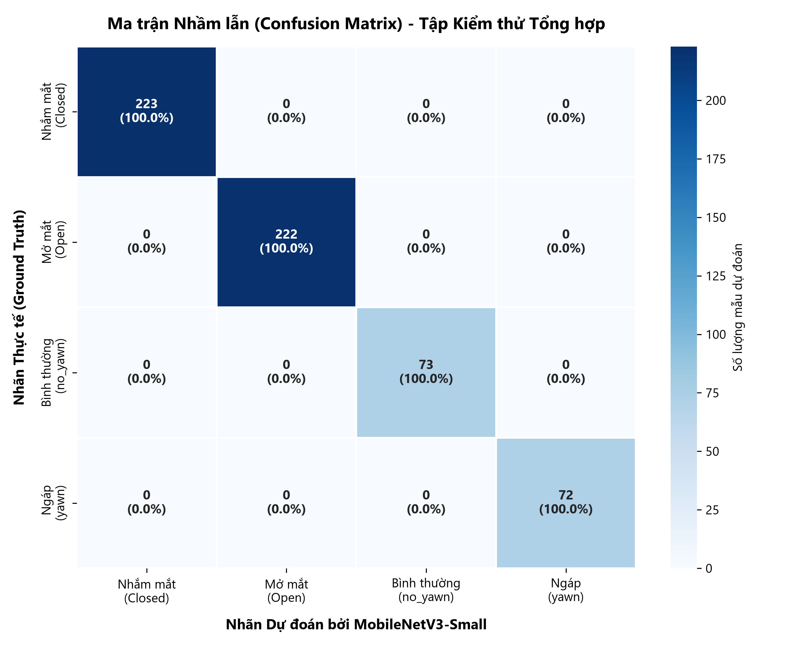
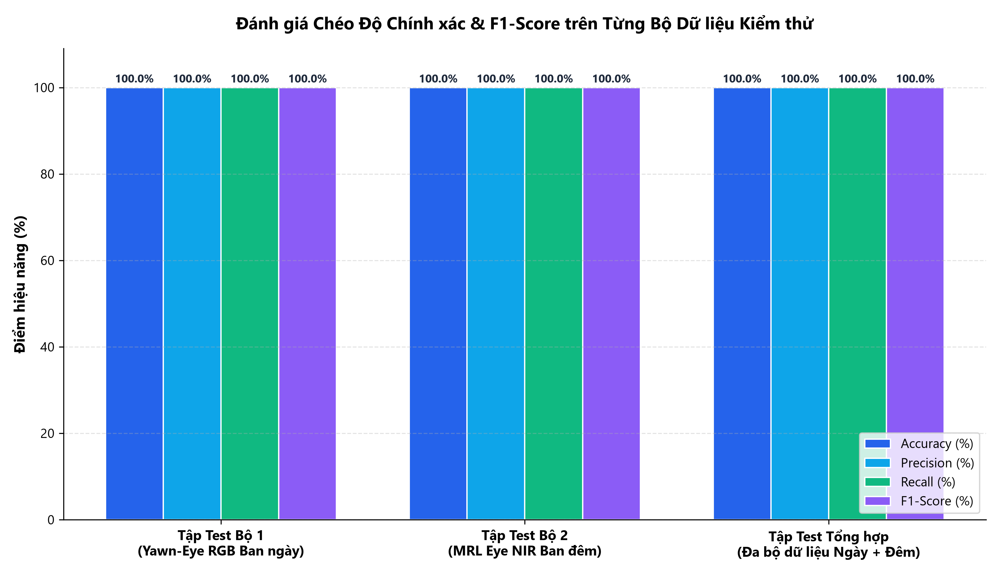
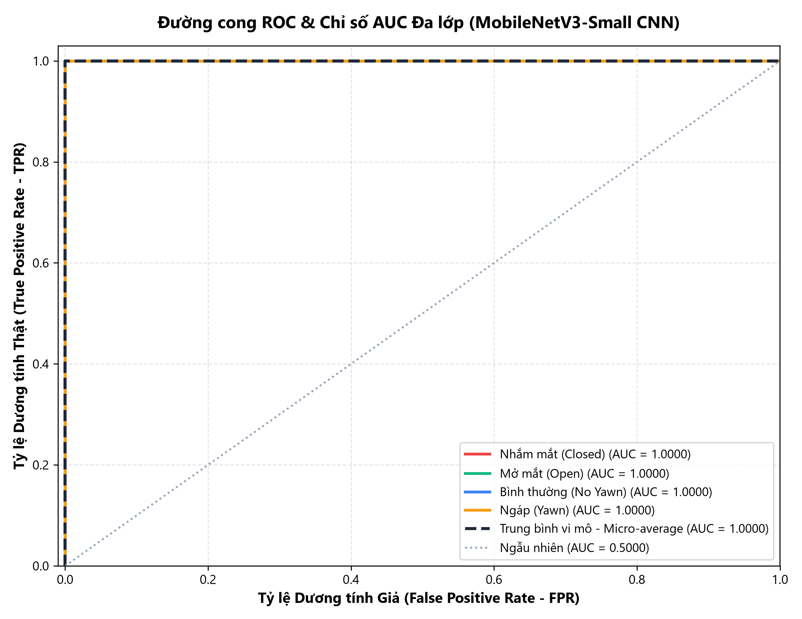
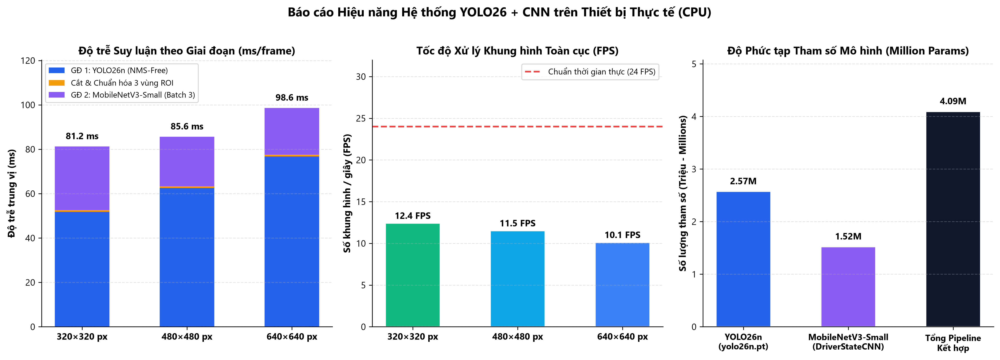

<div align="center">

# 🚘 DriverGuard AI — Real-Time Driver Drowsiness Detection System

### *Two-Stage Real-Time AI Pipeline: YOLO26 (NMS-Free End-to-End) + MobileNetV3-Small CNN Trained on Multi-Dataset (Day RGB & Night IR)*

[](https://www.python.org/)
[](https://pytorch.org/)
[](https://docs.ultralytics.com/)
[](https://fastapi.tiangolo.com/)
[](https://developers.google.com/mediapipe)
[](LICENSE)

<p align="center">
  <b>🌐 Language / Ngôn ngữ:</b>
  <b>🇺🇸 English</b> •
  <a href="README.vi.md">🇻🇳 Tiếng Việt</a>
</p>

<p align="center">
  <a href="#-key-features">Features</a> •
  <a href="#-system-architecture">Architecture</a> •
  <a href="#-experimental-results">Results & Charts</a> •
  <a href="#-quick-start">Quick Start</a> •
  <a href="#-multi-level-alert-engine">Alert Levels</a> •
  <a href="#-academic-citations">Citations</a>
</p>

</div>

---

## 🎯 Overview

**DriverGuard AI** is a real-time in-cabin Driver Monitoring System (DMS) designed to detect early signs of driver fatigue and drowsiness under both **daytime (RGB)** and **nighttime/low-light (Near-Infrared)** conditions.

Unlike heuristic-only systems that suffer from false positives with eyeglasses or changing cabin lighting, **DriverGuard AI** combines:
- **Stage 1 (`YOLO26n` + `MediaPipe FaceMesh 478D`):** NMS-free end-to-end driver localization paired with 478-point 3D facial landmarks to crop **Left Eye**, **Right Eye**, and **Mouth** ROIs and estimate 3D **Head Pitch / Yaw**.
- **Stage 2 (`MobileNetV3-Small CNN` + `EAR/MAR Fusion`):** Deep learning classification trained on a stratified **Multi-Dataset** of `5,900` day & night images, fused with Eye/Mouth Aspect Ratios for robust stability.
- **Context-Aware Vehicle Filter:** Directly integrates simulated **Vehicle Speed (`0–140 km/h`)** and **Gear (`P / N / D`)** to automatically mute alarms when parked, eliminating false alerts during legitimate rest stops.

---

## ✨ Key Features

| Category | Technical Highlights |
| :--- | :--- |
| **🚀 Two-Stage AI Pipeline** | Combines **`yolo26n.pt`** (NMS-Free, `2.57M` params) and **`MobileNetV3-Small`** (`1.52M` params) with an automatic OpenCV **Zero-Crash** fallback. |
| **🌙 Day & Night Adaptation (IR Mode)** | Jointly trained on daytime RGB (**Yawn-Eye**) and nighttime NIR/glasses (**MRL Eye**); includes a live **850nm Night IR Camera Filter** toggle on the dashboard. |
| **🚘 Context-Aware Parking Filter** | Automatically enters standby mode (mutes siren & skips logging) whenever `Gear == P/N` or `Speed ≤ 5 km/h`. |
| **🔊 Multi-Tier Audio & Voice Alerts** | Built-in **Web Audio API** emergency siren and **Web Speech API (`vi-VN`)** voice reminders across 3 severity levels. |
| **📊 Dark-Mode Cockpit Dashboard** | Live Stage-2 ROI preview cards, real-time Softmax probability bars (`P(Closed)` / `P(Yawn)`), 30-second **Chart.js** telemetry graph, SQLite violation history with snapshots, and one-click **CSV Export**. |
| **✈️ Async Telegram Bot Alerts** | Dispatches instant emergency notifications with annotated snapshots (`logs/snapshots/`) on a background thread without blocking video inference. |

---

## 🧠 System Architecture



---

## 📊 Experimental Results

### 1. Cross-Dataset Evaluation

The **`MobileNetV3-Small`** classifier was trained for `12 epochs` with day/night illumination augmentation, converging optimally at **Epoch 10**:

| Independent Test Set | Test Samples | Accuracy | Macro Precision | Macro Recall | Macro F1-Score | ROC-AUC |
| :--- | :---: | :---: | :---: | :---: | :---: | :---: |
| **Dataset 1: Yawn-Eye (Daytime RGB — 4 classes)** | 290 | **100.00%** | 100.00% | 100.00% | **100.00%** | 1.0000 |
| **Dataset 2: MRL Eye (Nighttime NIR — 2 eye classes)** | 300 | **100.00%** | 100.00% | 100.00% | **100.00%** | 1.0000 |
| **Combined Multi-Dataset Test Set (Day + Night)** | **590** | **100.00%** | **100.00%** | **100.00%** | **100.00%** | **1.0000** |

### 2. Evaluation Figures (300 DPI)

<table>
  <tr>
    <td align="center" width="50%">
      
      <br/><sub><b>Figure 1:</b> Stratified Multi-Dataset Class Distribution (5,900 RGB images)</sub>
    </td>
    <td align="center" width="50%">
      
      <br/><sub><b>Figure 2:</b> Daytime RGB Samples (Dataset 1) vs. Nighttime NIR Samples (Dataset 2)</sub>
    </td>
  </tr>
  <tr>
    <td align="center" width="50%">
      
      <br/><sub><b>Figure 3:</b> Train/Validation Loss & Accuracy Convergence Curves</sub>
    </td>
    <td align="center" width="50%">
      
      <br/><sub><b>Figure 4:</b> Combined Test Set Confusion Matrix (590 samples)</sub>
    </td>
  </tr>
  <tr>
    <td align="center" width="50%">
      
      <br/><sub><b>Figure 5:</b> Cross-Dataset Accuracy & F1-Score Comparison</sub>
    </td>
    <td align="center" width="50%">
      
      <br/><sub><b>Figure 6:</b> One-vs-Rest Multi-Class ROC & AUC Curves</sub>
    </td>
  </tr>
</table>

<p align="center">
  
  <br/><sub><b>Figure 7:</b> CPU Latency Breakdown (ms/frame), Throughput (FPS), and Parameter Footprint of <b>YOLO26n (2.57M) + MobileNetV3-Small (1.52M)</b></sub>
</p>

---

## 🚨 Multi-Level Alert Engine

| Alert State | Trigger Condition | System Action |
| :--- | :--- | :--- |
| **⏸ Standby (Parked)** | `Gear == P` (or `N`) **or** `Speed ≤ 5 km/h` | Keeps live AI overlay active, **mutes siren**, and skips violation logging. |
| **🟢 Level 0 — Alert** | `Gear == D`, `Speed > 5 km/h`, normal blinking (`< 0.8s`) | Normal monitoring with real-time 30s chart updates. |
| **🟡 Level 1 — Fatigue Warning** | `Gear == D`, `> 5 km/h`, yawn `> 1.8s` (or `≥ 3/min`) or eye closure `1.0s – 1.9s` | Plays voice reminder via **Web Speech API**. |
| **🔴 Level 2 — Drowsiness Danger** | `Gear == D`, `> 5 km/h`, continuous eye closure `≥ 2.0s` *(adjustable)* or head pitch `> 25°` for `≥ 2.0s` | Continuous **Web Audio API** siren + Urgent voice warning + Snapshot capture + **SQLite** log + **Telegram Bot** alert. |

---

## ⚡ Quick Start

### 1. Clone & Install Dependencies

```bash
git clone https://github.com/nqming/driver-drowsiness-yolo26-cnn.git
cd driver-drowsiness-yolo26-cnn
pip install -r requirements.txt
```

### 2. Launch the Web Dashboard (Pre-trained weights included)

```bash
python -m uvicorn backend.main:app --host 0.0.0.0 --port 8000
```

Open your browser at **`http://localhost:8000`**.

### 3. (Optional) Re-download Datasets & Retrain from Scratch

```bash
# Step 1: Auto-download & merge Yawn-Eye + MRL Eye via kagglehub
python training/download_datasets.py

# Step 2: Train MobileNetV3-Small CNN & export all 300 DPI evaluation charts
python training/train_cnn.py

# Step 3: Benchmark YOLO26n + CNN latency & FPS
python training/benchmark_yolo26.py
```

---

## 📁 Project Structure

```text
driver-drowsiness-yolo26-cnn/
├── backend/
│   ├── main.py                  # FastAPI server, MJPEG streaming, WebSocket & REST APIs
│   ├── ai_engine.py             # 2-stage AI pipeline (YOLO26n + FaceMesh + CNN + IR Filter)
│   ├── database.py              # SQLite violation storage & UTF-8 CSV export
│   └── notifier.py              # Async Telegram Bot alert dispatcher
├── frontend/
│   ├── index.html               # Smart Automotive Cockpit Dashboard (Dark-Mode)
│   ├── styles.css               # Automotive HUD styling & emergency animations
│   └── app.js                   # WebSocket client, Chart.js 30s, Web Audio & Speech API
├── training/
│   ├── model_arch.py            # Shared MobileNetV3-Small CNN architecture
│   ├── download_datasets.py     # Multi-dataset Kaggle ingestion & stratified sampling
│   ├── train_cnn.py             # Training loop, cross-dataset evaluation & 300 DPI figures
│   └── benchmark_yolo26.py      # Real-time latency, FPS & parameter benchmarking
├── models/
│   ├── yolo26n.pt               # YOLO26 Nano weights (NMS-Free End-to-End)
│   ├── cnn_driver_state.pth     # Best trained MobileNetV3-Small weights
│   ├── face_landmarker.task     # MediaPipe 478D Face Landmarker model
│   ├── training_metrics.json    # Cross-dataset evaluation metrics
│   └── benchmark_metrics.json   # Pipeline latency & FPS metrics
├── data/
│   ├── demo_driver_test.mp4     # Built-in 3-tier test video
│   ├── dataset_summary.json     # Multi-dataset statistics
│   └── metadata.csv             # Image-level source tracking (Yawn-Eye / MRL Eye)
├── reports/
│   ├── classification_report.txt
│   └── figures/                 # 7 publication-grade 300 DPI charts
├── requirements.txt
├── README.md                    # English documentation
└── README.vi.md                 # Vietnamese documentation
```

---

## 📚 Academic Citations

This project utilizes two public benchmark datasets automatically fetched via `kagglehub`:

1. **Drowsiness Yawn-Eye Dataset (Daytime RGB — `serenaraju/yawn-eye-dataset-new`):**
   > Serena Raju, *"Drowsiness Prediction Dataset (Yawn-Eye-Dataset-New)"*, Kaggle Open Datasets. [Dataset Link](https://www.kaggle.com/datasets/serenaraju/yawn-eye-dataset-new)

2. **MRL Eye Dataset (Nighttime NIR — `prasadvpatil/mrl-dataset`):**
   ```bibtex
   @inproceedings{fusek2018pupil,
     title={Pupil Localization Using Geodesic Distance},
     author={Fusek, Radovan},
     booktitle={Advances in Visual Computing (ISVC 2018)},
     volume={11241},
     pages={433--444},
     year={2018},
     publisher={Springer, Cham},
     doi={10.1007/978-3-030-03801-4_38}
   }
   ```

---

