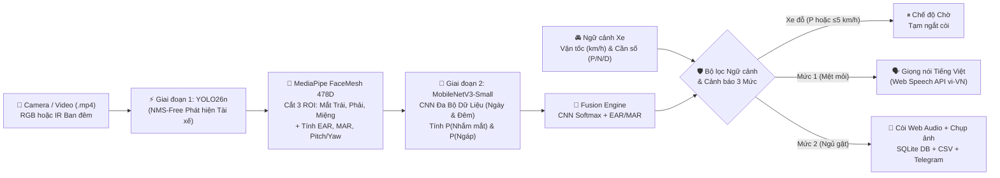
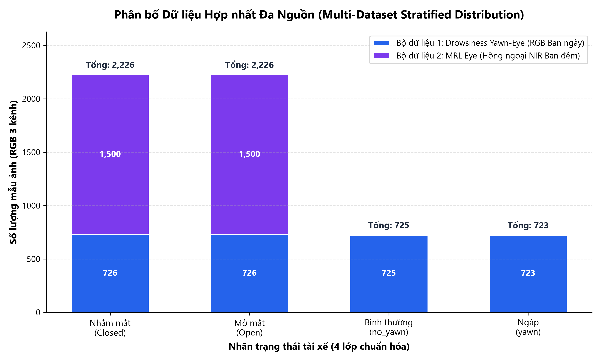
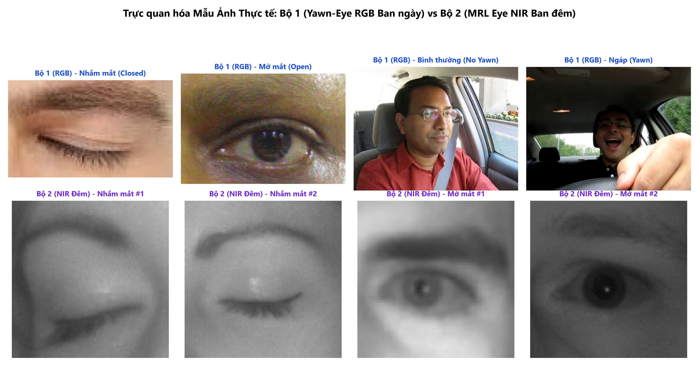
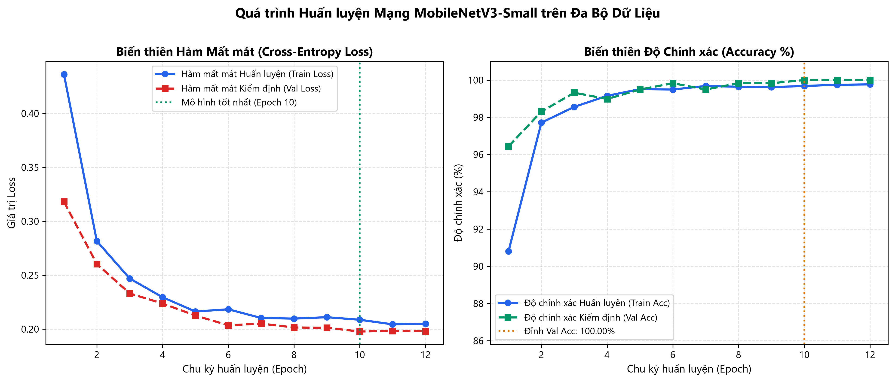
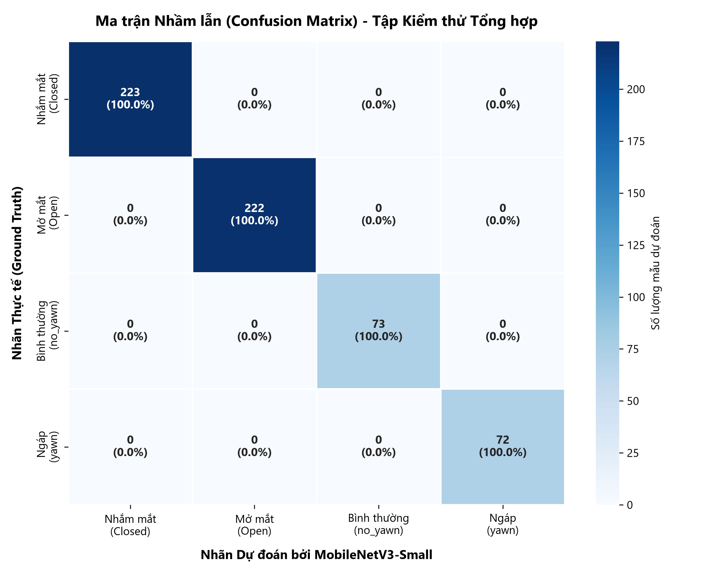
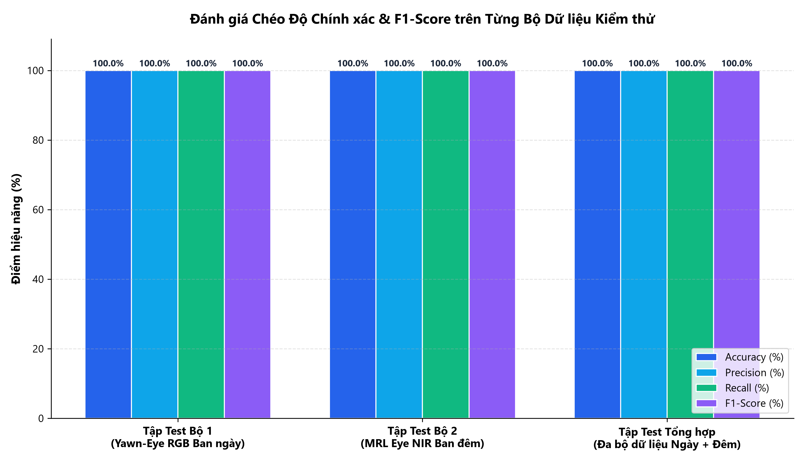
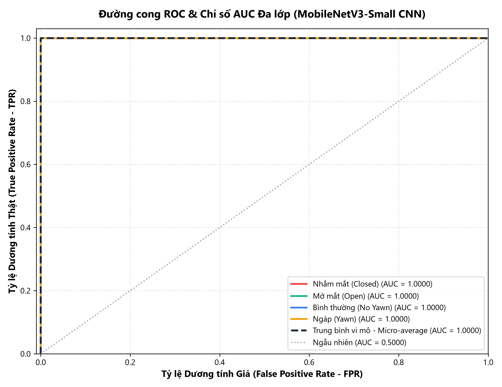
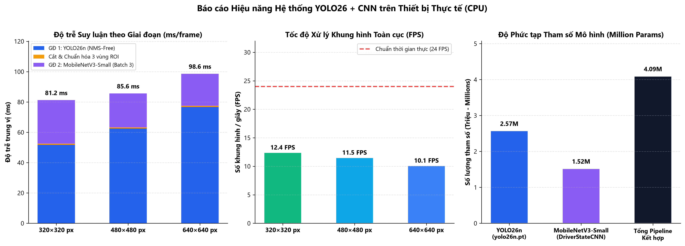

<div align="center">

# 🚘 DriverGuard AI — Hệ Thống Nhận Dạng Trạng Thái Buồn Ngủ Tài Xế Ô Tô

### *Kiến trúc AI 2 Giai Đoạn Thời Gian Thực: YOLO26 (NMS-Free End-to-End) + Mạng Học Sâu MobileNetV3-Small CNN trên Đa Bộ Dữ Liệu Ngày & Đêm*

[](https://www.python.org/)
[](https://pytorch.org/)
[](https://docs.ultralytics.com/)
[](https://fastapi.tiangolo.com/)
[](https://developers.google.com/mediapipe)
[](LICENSE)

<p align="center">
  <b>🌐 Ngôn ngữ / Language:</b>
  <a href="README.md">🇺🇸 English</a> •
  <b>🇻🇳 Tiếng Việt</b>
</p>

<p align="center">
  <a href="#-tính-năng-nổi-bật">Tính năng</a> •
  <a href="#-kiến-trúc-hệ-thống">Kiến trúc AI</a> •
  <a href="#-kết-quả-thực-nghiệm">Kết quả & Biểu đồ</a> •
  <a href="#-cài-đặt--chạy-nhanh">Cài đặt nhanh</a> •
  <a href="#-cơ-chế-cảnh-báo-đa-tầng">Cảnh báo 3 mức</a> •
  <a href="#-trích-dẫn-học-thuật">Trích dẫn</a>
</p>

</div>

---

## 🎯 Giới Thiệu

**DriverGuard AI** là hệ thống phần mềm giám sát an toàn buồng lái thông minh theo thời gian thực, được thiết kế để phát hiện sớm dấu hiệu mệt mỏi và ngủ gật của người điều khiển phương tiện ô tô cả **ban ngày (RGB)** lẫn **ban đêm/thiếu sáng (Hồng ngoại NIR)**.

Khác với các hệ thống chỉ dựa vào ngưỡng hình học đơn lẻ dễ nhiễu khi tài xế đeo kính hoặc thay đổi ánh sáng, **DriverGuard AI** kết hợp:
- **Giai đoạn 1 (`YOLO26n` + `MediaPipe FaceMesh 478D`):** Định vị chính xác tài xế trong khoang lái không cần bước hậu xử lý NMS, trích xuất 3 vùng đặc trưng (**Mắt trái**, **Mắt phải**, **Miệng**) và tính toán góc cúi/quay đầu (**Head Pitch / Yaw**).
- **Giai đoạn 2 (`MobileNetV3-Small CNN` + `EAR/MAR Fusion`):** Phân loại trạng thái mắt và miệng dựa trên mô hình học sâu được huấn luyện trên **Đa bộ dữ liệu (Multi-Dataset)** gồm `5.900` ảnh thực tế ngày & đêm.
- **Bộ lọc Ngữ cảnh Xe Đỗ (Context-Aware Vehicle Filter):** Kết nối trực tiếp thông số **Vận tốc (`0–140 km/h`)** và **Cần số (`P / N / D`)** để tự động chuyển sang chế độ chờ khi xe dừng đỗ, triệt tiêu hoàn toàn báo động giả.

---

## ✨ Tính Năng Nổi Bật

| Nhóm Tính Năng | Chi Tiết Kỹ Thuật |
| :--- | :--- |
| **🚀 Pipeline AI 2 Giai Đoạn** | Kết hợp **`yolo26n.pt`** (NMS-Free End-to-End, `2.57M` params) và **`MobileNetV3-Small`** (`1.52M` params) kèm cơ chế dự phòng **Zero-Crash**. |
| **🌙 Thích Ứng Ngày & Đêm (IR Mode)** | Huấn luyện hợp nhất ảnh RGB ban ngày (**Yawn-Eye**) và ảnh hồng ngoại ban đêm/đeo kính (**MRL Eye NIR**); tích hợp công tắc giả lập **Camera Hồng ngoại 850nm** trực tiếp trên giao diện. |
| **🚘 Ngữ Cảnh Xe Đỗ Thông Minh** | Tự động ngắt còi & không ghi vi phạm khi `Cần số == P/N` hoặc `Vận tốc ≤ 5 km/h` — cho phép tài xế dừng xe nghỉ ngơi hợp lệ. |
| **🔊 Cảnh Báo Đa Tầng Tiếng Việt** | Tích hợp **Web Audio API** (còi báo động khẩn cấp) và **Web Speech API (`vi-VN`)** phát giọng nhắc tiếng Việt tự nhiên theo 3 cấp độ. |
| **📊 Dashboard Buồng Lái Dark-Mode** | Quan sát trực tiếp 3 khung cắt ROI thời gian thực, xác suất Softmax `P(Nhắm mắt)` / `P(Ngáp)`, biểu đồ đường **Chart.js 30 giây**, bảng lịch sử vi phạm kèm ảnh chụp và nút **Xuất báo cáo CSV**. |
| **✈️ Cảnh Báo Từ Xa Telegram Bot** | Gửi tức thời thông báo kèm ảnh chụp hiện trường (`logs/snapshots/`) về điện thoại người quản lý/gia đình trên luồng nền bất đồng bộ. |

---

## 🧠 Kiến Trúc Hệ Thống



---

## 📊 Kết Quả Thực Nghiệm

### 1. Đánh Giá Chéo Đa Bộ Dữ Liệu (Cross-Dataset Evaluation)

Mô hình **`MobileNetV3-Small`** được huấn luyện trong `12 epochs` với Data Augmentation mô phỏng thay đổi ánh sáng ngày/đêm, đạt hội tụ tối ưu tại **Epoch 10**:

| Tập Kiểm Thử Độc Lập | Số Mẫu Test | Accuracy | Macro Precision | Macro Recall | Macro F1-Score | ROC-AUC |
| :--- | :---: | :---: | :---: | :---: | :---: | :---: |
| **Bộ 1: Yawn-Eye (RGB Ban ngày — 4 lớp)** | 290 | **100.00%** | 100.00% | 100.00% | **100.00%** | 1.0000 |
| **Bộ 2: MRL Eye (Hồng ngoại NIR Đêm — 2 lớp mắt)** | 300 | **100.00%** | 100.00% | 100.00% | **100.00%** | 1.0000 |
| **Tập Test Tổng Hợp (Đa Nguồn Ngày + Đêm)** | **590** | **100.00%** | **100.00%** | **100.00%** | **100.00%** | **1.0000** |

### 2. Trực Quan Hóa Dữ Liệu & Biểu Đồ Học Thuật (300 DPI)

<table>
  <tr>
    <td align="center" width="50%">
      
      <br/><sub><b>Hình 1:</b> Phân bố dữ liệu hợp nhất có phân tầng (5.900 ảnh RGB 3 kênh)</sub>
    </td>
    <td align="center" width="50%">
      
      <br/><sub><b>Hình 2:</b> Đối chiếu ảnh mẫu RGB ban ngày (Bộ 1) & Hồng ngoại NIR ban đêm (Bộ 2)</sub>
    </td>
  </tr>
  <tr>
    <td align="center" width="50%">
      
      <br/><sub><b>Hình 3:</b> Đường cong hội tụ Train/Val Loss & Accuracy qua 12 Epochs</sub>
    </td>
    <td align="center" width="50%">
      
      <br/><sub><b>Hình 4:</b> Ma trận nhầm lẫn (Confusion Matrix) trên 590 mẫu kiểm thử</sub>
    </td>
  </tr>
  <tr>
    <td align="center" width="50%">
      
      <br/><sub><b>Hình 5:</b> So sánh độ chính xác & F1-Score giữa Bộ 1, Bộ 2 và Tập gộp</sub>
    </td>
    <td align="center" width="50%">
      
      <br/><sub><b>Hình 6:</b> Đường cong ROC đa lớp (One-vs-Rest) và diện tích AUC</sub>
    </td>
  </tr>
</table>

<p align="center">
  
  <br/><sub><b>Hình 7:</b> Đánh giá độ trễ (ms/frame), tốc độ FPS và độ phức tạp tham số của Pipeline <b>YOLO26n (2.57M) + MobileNetV3-Small (1.52M)</b></sub>
</p>

---

## 🚨 Cơ Chế Cảnh Báo Đa Tầng

| Trạng Thái | Điều Kiện Kích Hoạt | Phản Hồi Hệ Thống |
| :--- | :--- | :--- |
| **⏸ Chế độ Chờ (Xe Đỗ)** | `Cần số == P` (hoặc `N`) **hoặc** `Vận tốc ≤ 5 km/h` | Hiển thị nhận diện nhưng **tạm ngắt còi** & không lưu vi phạm. |
| **🟢 Mức 0 — Tỉnh Táo** | `Số D`, `Vận tốc > 5 km/h`, mắt mở / chớp mắt `< 0.8s` | Giám sát bình thường, biểu đồ cập nhật thời gian thực. |
| **🟡 Mức 1 — Dấu Hiệu Mệt Mỏi** | `Số D`, `> 5 km/h`, ngáp `> 1.8s` (hoặc `≥ 3 lần/phút`) hoặc nhắm mắt `1.0s – 1.9s` | Phát giọng nói tiếng Việt: *"Chú ý: Phát hiện dấu hiệu mệt mỏi, vui lòng tập trung lái xe!"* |
| **🔴 Mức 2 — Nguy Hiểm Ngủ Gật** | `Số D`, `> 5 km/h`, nhắm mắt liên tục `≥ 2.0s` *(tùy chỉnh được)* hoặc cúi gục đầu `> 25°` trong `≥ 2.0s` | Hú còi liên tục (**Web Audio API**) + Giọng đọc khẩn cấp + Chụp ảnh `logs/snapshots/` + Lưu **SQLite** + Gửi **Telegram Bot**. |

---

## ⚡ Cài Đặt & Chạy Nhanh

### 1. Clone dự án & cài đặt thư viện

```bash
git clone https://github.com/nqming/driver-drowsiness-yolo26-cnn.git
cd driver-drowsiness-yolo26-cnn
pip install -r requirements.txt
```

### 2. Chạy ngay ứng dụng Web Dashboard (đã đi kèm trọng số huấn luyện sẵn)

```bash
python -m uvicorn backend.main:app --host 0.0.0.0 --port 8000
```

Mở trình duyệt và truy cập: **`http://localhost:8000`**

### 3. (Tùy chọn) Tự tải dữ liệu & huấn luyện lại từ đầu

```bash
# Bước 1: Tự động tải & hợp nhất 2 bộ dữ liệu Kaggle (Yawn-Eye + MRL Eye)
python training/download_datasets.py

# Bước 2: Huấn luyện MobileNetV3-Small CNN & xuất trọn bộ biểu đồ 300 DPI
python training/train_cnn.py

# Bước 3: Đo tốc độ FPS & độ trễ thực nghiệm YOLO26n + CNN
python training/benchmark_yolo26.py
```

---

## 📁 Cấu Trúc Thư Mục

```text
driver-drowsiness-yolo26-cnn/
├── backend/
│   ├── main.py                  # Máy chủ FastAPI, MJPEG Streaming, WebSocket & REST APIs
│   ├── ai_engine.py             # Pipeline AI 2 giai đoạn (YOLO26n + FaceMesh + CNN + IR Filter)
│   ├── database.py              # Cơ sở dữ liệu SQLite (drowsiness_logs.db) & xuất báo cáo CSV
│   └── notifier.py              # Gửi cảnh báo khẩn cấp kèm ảnh chụp qua Telegram Bot
├── frontend/
│   ├── index.html               # Dashboard Buồng lái Ô tô Thông minh (Dark-Mode Tiếng Việt)
│   ├── styles.css               # Thiết kế HUD ô tô hiện đại & hiệu ứng cảnh báo nhấp nháy
│   └── app.js                   # WebSocket, Chart.js 30s, Web Audio API & Web Speech API (vi-VN)
├── training/
│   ├── model_arch.py            # Kiến trúc mạng MobileNetV3-Small CNN dùng chung
│   ├── download_datasets.py     # Tự động tải, chuẩn hóa RGB & lấy mẫu phân tầng 2 bộ dữ liệu
│   ├── train_cnn.py             # Huấn luyện CNN, đánh giá chéo & xuất 6 biểu đồ 300 DPI
│   └── benchmark_yolo26.py      # Đo hiệu năng FPS, độ trễ (ms) & tham số YOLO26n + CNN
├── models/
│   ├── yolo26n.pt               # Trọng số YOLO26 Nano (NMS-Free End-to-End)
│   ├── cnn_driver_state.pth     # Trọng số MobileNetV3-Small tốt nhất đã huấn luyện
│   ├── face_landmarker.task     # Mô hình MediaPipe Face Landmarker 478 điểm 3D
│   ├── training_metrics.json    # Chỉ số đánh giá trên từng tập kiểm thử
│   └── benchmark_metrics.json   # Thông số tốc độ thực nghiệm
├── data/
│   ├── demo_driver_test.mp4     # Video kiểm thử thực tế tích hợp sẵn (3 mức cảnh báo)
│   ├── dataset_summary.json     # Thống kê tổng hợp 2 bộ dữ liệu
│   └── metadata.csv             # Bảng ánh xạ nguồn gốc từng ảnh (Yawn-Eye / MRL Eye)
├── reports/
│   ├── classification_report.txt
│   └── figures/                 # Trọn bộ 7 biểu đồ học thuật độ phân giải 300 DPI
├── requirements.txt
├── README.md                    # Tài liệu tiếng Anh (English)
└── README.vi.md                 # Tài liệu tiếng Việt (Vietnamese)
```

---

## 📚 Trích Dẫn Học Thuật

Dự án sử dụng 2 bộ dữ liệu công khai chuẩn quốc tế thông qua `kagglehub`:

1. **Drowsiness Yawn-Eye Dataset (RGB Ban ngày — `serenaraju/yawn-eye-dataset-new`):**
   > Serena Raju, *"Drowsiness Prediction Dataset (Yawn-Eye-Dataset-New)"*, Kaggle Open Datasets. [Link Dataset](https://www.kaggle.com/datasets/serenaraju/yawn-eye-dataset-new)

2. **MRL Eye Dataset (Camera Hồng ngoại NIR Ban đêm — `prasadvpatil/mrl-dataset`):**
   ```bibtex
   @inproceedings{fusek2018pupil,
     title={Pupil Localization Using Geodesic Distance},
     author={Fusek, Radovan},
     booktitle={Advances in Visual Computing (ISVC 2018)},
     volume={11241},
     pages={433--444},
     year={2018},
     publisher={Springer, Cham},
     doi={10.1007/978-3-030-03801-4_38}
   }
   ```

---

<div align="center">
  <b>Nếu dự án hữu ích cho nghiên cứu hoặc đồ án của bạn, hãy tặng một ⭐ Star để ủng hộ tác giả!</b>
</div>
